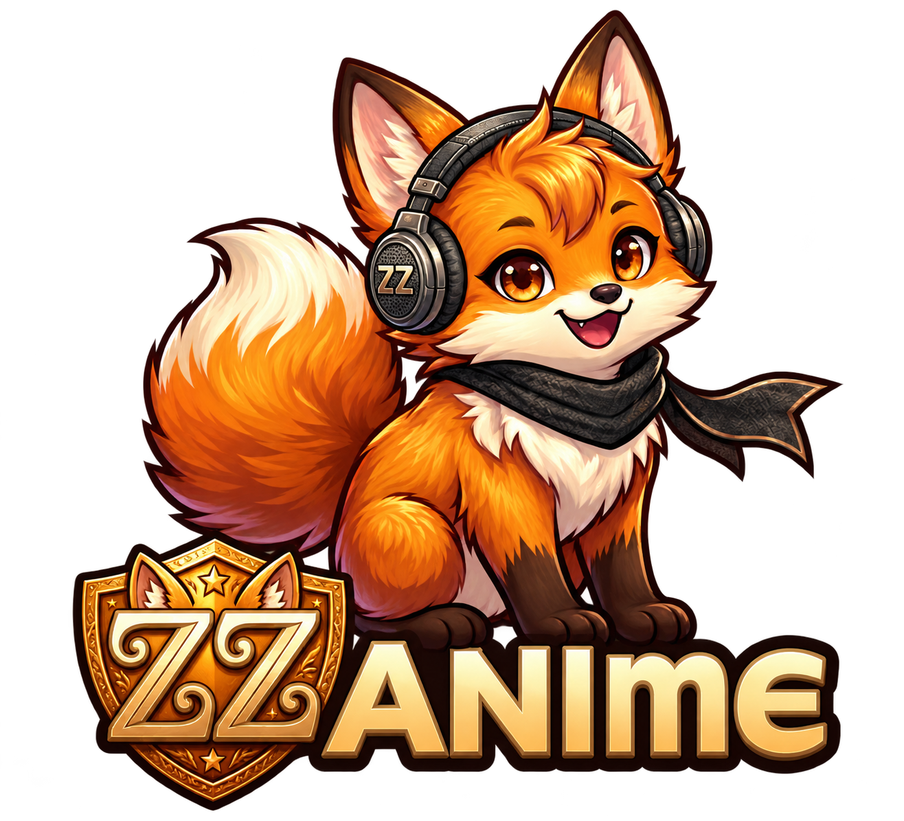

<h1 align="center">ZZAnime · Android TV y Móvil</h1>

Tu anime, a tu ritmo. En la tele y en el bolsillo.

<a href="https://github.com/ZZCoreDev/ZZAnime/releases/latest/download/ZZAnimeTV.apk">📺 Descargar para TV</a> · <a href="https://github.com/ZZCoreDev/ZZAnime/releases/latest/download/ZZAnimeMobile.apk">📱 Descargar para móvil</a>

## Tu biblioteca, en ambas pantallas

| Descubre | Continúa |
|---|---|
| Inicio visual, catálogo, buscador, ranking y horario semanal. | Favoritos, historial, capítulos vistos y progreso de reproducción. |
| Fuentes alternativas con opciones reales por capítulo e idioma indicado. | Cuenta privada y sincronización entre móvil y TV. |
| Navegación con mando en TV y controles táctiles en móvil. | Perfil, estadísticas y logros. |

## Instalar o actualizar

Descarga **un APK**, el de tu dispositivo. Requiere Android6.0 o posterior y conexión a Internet. Para actualizar, instala sobre la versión anterior **sin desinstalar**: conservarás tus datos. Ambas ediciones muestran la versión1.1; las revisiones usan un contador interno.

Las próximas actualizaciones se comprueban desde la app. También están en [Descargas](https://github.com/ZZCoreDev/ZZAnime/releases/latest). Los archivosJSON y de compatibilidad se utilizan para mantener las actualizaciones; no necesitas instalarlos.

## Tu cuenta

Crea tu usuario y contraseña para mantener una biblioteca privada. Guarda tu código de recuperación. Puedes vincular la TV mediante QR/código aprobado desde el móvil y gestionar tu perfil desde la app. Cada persona debe usar su propia cuenta.

## Reproducción

El reproductor permite elegir **Servidor1, Servidor2 o Servidor3**. Las opciones disponibles y el idioma dependen del capítulo. La disponibilidad de vídeos y la compatibilidad de los controles dependen de los proveedores externos; no se garantiza que todos los enlaces funcionen.

## Ayuda

[Comunicar un problema](https://github.com/ZZCoreDev/ZZAnime/issues). Indica dispositivo, serie, capítulo y opción de reproducción, sin publicar contraseñas ni códigos privados.

Proyecto independiente. Este repositorio distribuye aplicaciones y actualizaciones; no aloja episodios.
